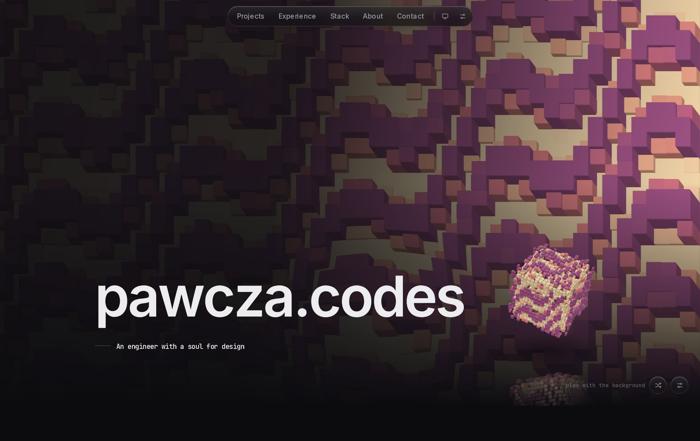

# pawcza.codes

My personal site and portfolio. Live at [pawcza.codes](https://pawcza.codes).

A single page with a living background: a field of tiles driven by a wave, bent by your cursor, and tunable from a settings panel. A toy cube floats beside the title. You can throw it.



Built with Next.js, React, TypeScript, Tailwind CSS, three.js and hand-written GLSL. It adapts to slower machines by itself, and all the content is typed data in [`src/content/`](src/content).

## Run it

```bash
pnpm install
pnpm dev
```

## License

The code is MIT. The CV, images, videos and written content are not licensed for reuse. See [LICENSE](LICENSE).
