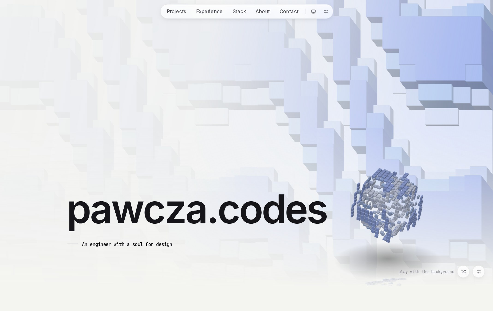

# pawcza.codes

The personal site and portfolio of Paweł Czarniecki, a senior front-end developer and designer in Gdynia, Poland. Live at [pawcza.codes](https://pawcza.codes).

It is a single page, and its centrepiece is a living background: a field of tiles driven by a wave, bent by a lens that follows the cursor, and fully tunable by the visitor. Beside the title floats a toy cube built from the same field. Drag it, let go, and it flies.




## The interesting parts

### A tile field that costs the same at any tile size

The first Canvas2D version sent every tile to the GPU as its own draw operation, a few thousand per frame on a large screen, and sank to about 25fps on a 3060 Ti. The field is now one full-screen triangle and a fragment shader that works out, for each pixel, which tile it belongs to and what colour that tile is this frame. See [`tileGl.ts`](src/components/hero/tileGl.ts).

- The lens pushes grid points outward along a cubic Hermite curve, which meets the untouched grid at matching slope so there is no crease. Drawing needs the reverse mapping, so the shader inverts the curve per pixel with a few Newton steps.
- Relief turns every tile into a block lifted off the page by the wave. For each pixel the shader finds which nearby block reaches highest there, and whether that point is on its top or a side.
- [`TileCanvas.tsx`](src/components/hero/TileCanvas.tsx) keeps all the motion on the CPU: eased settings, a Lissajous drift, the handover between drift and cursor, and palette cross-fades. Wave phase is accumulated rather than derived from elapsed time, so changing the speed never makes the pattern lurch.
- Where WebGL is missing, a Canvas2D renderer draws the same picture, warping shared grid vertices so lensed tiles never overlap.

### Performance that adapts instead of giving up

A full-screen animation has to behave on every machine, and a fixed "too slow" line cannot work when 37fps is fine at 60Hz and a disaster at 165Hz. [`gpu.ts`](src/components/common/gpu.ts) measures the display's real refresh interval while the loader is up, and probes for software rendering.

A watchdog then times real, visible animation in windows, skipping warm-up and scrolling. A slow window steps the quality down: first a lower resolution, then half the frame rate, and only a page still crawling after both falls back to a still frame. Every loop stops when it is off screen or the tab is hidden, and `prefers-reduced-motion` gets a still frame from the start.

### The toy cube

[`cubeToy.ts`](src/components/cube/cubeToy.ts) is a small three.js engine with no physics library.

- Each face of the cube is one `InstancedMesh` block per tile. The page's own fragment shader renders into a texture, every block samples it at its tile's centre, and the same wave function sets how far the block stands out.
- Throwing it works like a slingshot. A drag pulls the cube against a band that stiffens with distance. On release the band snaps it back through its anchor, and it flies free with friction and air drag acting separately, so a gentle throw stops quickly and a hard one coasts.
- Once it slows, a spring swings its upright axis back up with a slight wobble, damping only the tipping and never the turn about that axis.
- It floats over a floor that exists only as a soft shadow and a mirrored copy of the cube, fading with depth. The floor lowers at once when a corner swings down and rises back slowly.
- Its brightness follows the palette, so pale and dark palettes both land in the same luminance band and the blocks keep their shape.

### A settings panel for all of it

Visitors can change everything: twelve hand-tuned presets, palettes with a custom mix interpolated in OKLab, the wave's shape, the lens or grid effect, and the cube's relief, blocks and core. Changes ease into place, so a shuffle glides instead of cutting. See [`Controls.tsx`](src/components/hero/Controls.tsx) and [`presets.ts`](src/components/hero/presets.ts).

### Smaller details

- Body text builds in square by square through a CSS mask that simplifies as squares land, while staying readable by screen readers ([`SquareText.tsx`](src/components/common/SquareText.tsx)).
- Project covers assemble from about 160 `drawImage` slices on one canvas, which replaced 160 animated DOM layers per cover ([`TileReveal.tsx`](src/components/work/TileReveal.tsx)).
- The ambient glow behind the page is a canvas with one pixel per cell, scaled up with `image-rendering: pixelated` ([`AmbientField.tsx`](src/components/common/AmbientField.tsx)).
- The contact form has spam guards and no dependencies: a honeypot, a minimum fill time and a per-IP rate limit, with bots told their message was sent ([`contact/route.ts`](src/app/contact/route.ts)).

## Stack

Next.js 16 (App Router), React 18, TypeScript, Tailwind CSS, Motion, three.js and hand-written GLSL. Images are built with Docker and published to GHCR by GitHub Actions.

There is no CMS. Everything on the page is typed data in [`src/content/`](src/content):

| File            | What it drives                          |
| --------------- | --------------------------------------- |
| `profile.ts`    | Name, role, tagline, bio, contact links |
| `experience.ts` | The experience timeline                 |
| `projects.ts`   | The project list and its modals         |
| `skills.ts`     | The stack section                       |

The CV is served from `/cv`, and `/quote` proxies a random quote.

## Running it

Requires Node 20 or newer and pnpm 10.

```bash
pnpm install
pnpm dev        # https://localhost:3000, with a self-signed certificate
```

Checks and a production build:

```bash
pnpm typecheck
pnpm lint
pnpm build && pnpm start
```

Or with Docker:

```bash
docker build -t pawcza.codes .
docker run -p 3000:3000 -e CONTACT_NTFY_TOPIC=your-topic pawcza.codes
```

The contact form pushes messages through [ntfy](https://ntfy.sh):

| Variable             | Purpose                                     |
| -------------------- | ------------------------------------------- |
| `CONTACT_NTFY_TOPIC` | Required for the form. Keep it unguessable. |
| `NTFY_SERVER`        | Optional. Defaults to `https://ntfy.sh`.    |

Production builds load analytics from `/stats/script.js`, which the reverse proxy serves. Without that proxy the request returns 404, which is harmless.

## License

The code is MIT licensed. The CV, images, videos, written content and project material are not licensed for reuse. See [LICENSE](LICENSE).
